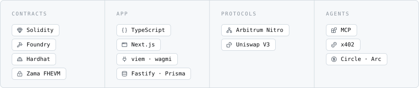
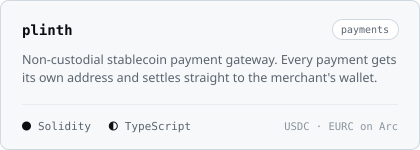
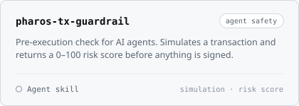
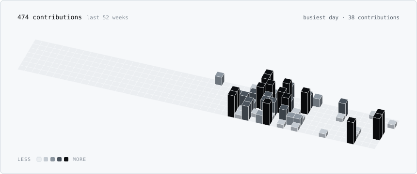

<picture>
  <source media="(prefers-color-scheme: dark)" srcset="assets/header-dark.svg">
  
</picture>

<picture>
  <source media="(prefers-color-scheme: dark)" srcset="assets/whoami-dark.svg">
  
</picture>

## Stack

<picture>
  <source media="(prefers-color-scheme: dark)" srcset="assets/stack-dark.svg">
  
</picture>

## Building

<a href="https://github.com/hosein-ul/plinth"><picture>
  <source media="(prefers-color-scheme: dark)" srcset="assets/card-plinth-dark.svg">
  
</picture></a>
<a href="https://github.com/hosein-ul/pharos-tx-guardrail"><picture>
  <source media="(prefers-color-scheme: dark)" srcset="assets/card-pharos-tx-guardrail-dark.svg">
  
</picture></a>

## What I work on

- **Stablecoin payments.** Non-custodial rails where funds go straight from payer to merchant, with no middle wallet holding anyone's money.
- **Private onchain finance.** Apps on fully homomorphic encryption, where balances and positions stay encrypted while contracts still compute on them.
- **Agent safety.** Guardrails that let AI agents simulate and score a transaction before they sign it.
- **Security research.** Independent bug bounty work on web3 and DeFi protocols, reported through responsible disclosure.

## Writing

I also write about infrastructure, explaining how chains, rollups and payment systems work for people who don't read specs for fun. Threads and long posts on X.

## Activity

<picture>
  <source media="(prefers-color-scheme: dark)" srcset="assets/stats-dark.svg">
  
</picture>

<picture>
  <source media="(prefers-color-scheme: dark)" srcset="assets/calendar-dark.svg">
  
</picture>

<picture>
  <source media="(prefers-color-scheme: dark)" srcset="https://raw.githubusercontent.com/hosein-ul/hosein-ul/output/snake-dark.svg">
  
</picture>

## Connect

[X @andy1eth](https://x.com/andy1eth) · [Telegram @hoseinf3](https://t.me/hoseinf3) · [GitHub @hosein-ul](https://github.com/hosein-ul)
