 

## ⚡ About Me & Engineering Philosophy

I am a **Web3 systems architect and smart contract developer**, active on-chain since 2021. My work is focused on the architecture of **non-custodial financial rails**, **confidential state execution** via Fully Homomorphic Encryption (FHEVM), and **high-throughput L2 exchange infrastructure**.

Rather than relying on centralized intermediaries or custodial escrows, I design decentralized protocols where liquidity moves directly from payer to merchant, where smart contracts compute over fully encrypted balances without revealing private financial data to the mempool, and where autonomous AI agents can safely simulate transactions before committing capital on-chain.

---

## 🔬 Core Engineering Pillars

### 1. 🪙 Non-Custodial Stablecoin Rails
- **Architecture**: Peer-to-merchant payment rails where every transaction is assigned a deterministic, single-use address and settles straight to the recipient's wallet.
- **Key Advantage**: Zero custodial middleman, zero escrow custody risk, and seamless multi-token settlement (native USDC and EURC) deployed on low-latency networks like Circle Arc.

### 2. 🛡️ Confidential On-Chain Finance (FHEVM)
- **Architecture**: Application-level cryptographic privacy on Ethereum using Zama's Fully Homomorphic Encryption Virtual Machine and the ERC-7984 confidential token standard.
- **Key Advantage**: Enables contracts to perform arithmetic, state transitions, and balance transfers directly on encrypted ciphertexts (`euint64`), preserving total user privacy without sacrificing EVM composability or validator consensus.

### 3. ⚡ High-Throughput L2 DEX Infrastructure
- **Architecture**: Production-grade decentralized trading platforms engineered on the Arbitrum Nitro L2 stack (such as Optima DEX on Robinhood Chain Mainnet).
- **Key Advantage**: Combines concentrated liquidity (Uniswap V3), RFQ off-chain quote settlement for real-world equity tokens, and sub-second execution with Next.js 16, React 19, and Viem.

### 4. 🤖 Autonomous Agent Safety & x402 Micropayments
- **Architecture**: Pre-execution simulation engines for autonomous AI agents handling on-chain treasuries.
- **Key Advantage**: Performs bytecode simulation and generates an algorithmic 0–100 risk score prior to signing, paired with HTTP 402 (x402) micropayments for seamless agent-to-agent (A2A) service exchange.

---

## 🚀 Flagship Deployments & Research

| Project | Overview & Architecture | Tech Stack |
|:---|:---|:---:|
| 🟢 **[Optima DEX](https://github.com/hosein-ul/optima-pon)** | High-throughput L2 DEX on Robinhood Chain Mainnet. Built on Arbitrum Nitro stack with Uniswap V3 concentrated liquidity, Rialto RFQ settlement for stock tokens, and the Pons launchpad. | `Arbitrum Nitro L2` `Viem` `Next.js 16` |
| ⚡ **[Plinth](https://github.com/hosein-ul/plinth)** | Non-custodial stablecoin gateway with dedicated invoice addresses. Automatically settles USDC and EURC straight to merchant wallets on Circle Arc with zero escrow fees. | `Circle Arc` `Solidity` `USDC` |
| 🛡️ **[ShadowLine](https://github.com/hosein-ul/ShadowLine)** | Confidential asset shielding framework powered by Zama FHEVM. Implements ERC-7984 confidential wrapping, encrypted transfers, and zero-leakage unshielding. | `Zama FHEVM` `ERC-7984` `Solidity` |
| 🤖 **[Pharos Tx Guardrail](https://github.com/hosein-ul/pharos-tx-guardrail)** | Pre-execution safety oracle and transaction simulation engine for autonomous AI agents. Inspects calldata and outputs risk metrics before any private key signs. | `Agent Safety` `TypeScript` `Simulations` |
| 🔮 **[Truth-Market](https://github.com/hosein-ul/Truth-Market)** | Confidential on-chain prediction market on FHEVM. Enables participants to place wagers while keeping prediction bets and volume private until market resolution. | `FHEVM` `Privacy DeFi` `Solidity` |
| 🌐 **[AgentOS](https://github.com/hosein-ul/AgentOS)** | Multi-tenant agent execution layer for marketplace integrations. Supports autonomous agent-to-agent (A2A) tasks and x402 pay-per-call REST APIs. | `x402` `A2A Protocols` `TypeScript` |

---

## 🛠️ Technical Arsenal

<b>Smart Contracts & Web3 Protocols</b>

  
  
  
  
  
  
  
  

<b>Full-Stack, Systems & AI</b>

  
  
  
  
  
  
  
  

 

---

## ✍️ Technical Writing & Infrastructure Analysis

In addition to building software, I write deep-dives on infrastructure design:
- How modern rollups, state transition proofs, and payment rails operate under the hood.
- Dissecting complex protocol specifications and cryptographic invariants into intuitive mental models.
- Architectural threads and analyses published on [X (@andy1eth)](https://x.com/andy1eth).

---

## 📊 Live Metrics & Contributions

 

---

## 📬 Connect & Inquiries

&nbsp;

&nbsp;

&nbsp;

