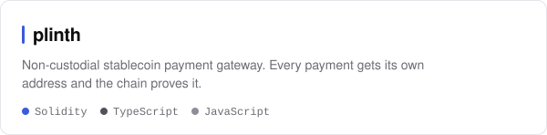
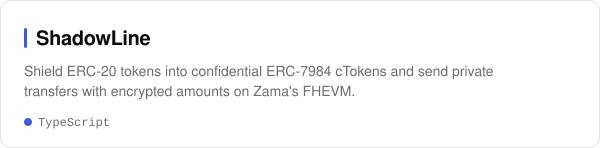
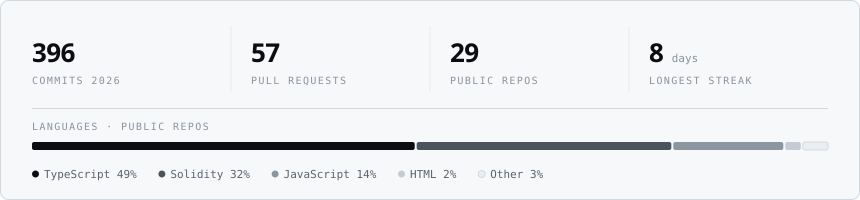

<picture>
  <source media="(prefers-color-scheme: dark)" srcset="assets/header-dark.svg">
  
</picture>

I build practical blockchain tools and apps, hunt for bugs in web3 and DeFi protocols, and write about infrastructure until it makes sense to people who don't live in it.
Active onchain since late 2021, with a long-running interest in stablecoin infrastructure, programmable money, and AI agents that pay onchain.

`Solidity` `TypeScript` `Foundry` `Hardhat` `Next.js` `viem` `wagmi` `Zama FHEVM` `Fastify` `Prisma`

## Featured projects

<a href="https://github.com/hosein-ul/plinth">
  <picture>
    <source media="(prefers-color-scheme: dark)" srcset="assets/cards/plinth-dark.svg">
    
  </picture>
</a>
<a href="https://github.com/hosein-ul/ShadowLine">
  <picture>
    <source media="(prefers-color-scheme: dark)" srcset="assets/cards/shadowline-dark.svg">
    
  </picture>
</a>
<a href="https://github.com/hosein-ul/Truth-Market">
  <picture>
    <source media="(prefers-color-scheme: dark)" srcset="assets/cards/truth-market-dark.svg">
    
  </picture>
</a>
<a href="https://github.com/hosein-ul/pharos-tx-guardrail">
  <picture>
    <source media="(prefers-color-scheme: dark)" srcset="assets/cards/pharos-tx-guardrail-dark.svg">
    
  </picture>
</a>

## Activity

<picture>
  <source media="(prefers-color-scheme: dark)" srcset="https://raw.githubusercontent.com/hosein-ul/hosein-ul/output/snake-dark.svg">
  
</picture>

<picture>
  <source media="(prefers-color-scheme: dark)" srcset="assets/stats-dark.svg">
  
</picture>

## Connect

[GitHub](https://github.com/hosein-ul) · [Telegram](https://t.me/hoseinf3) · [X](https://x.com/andy1eth)
